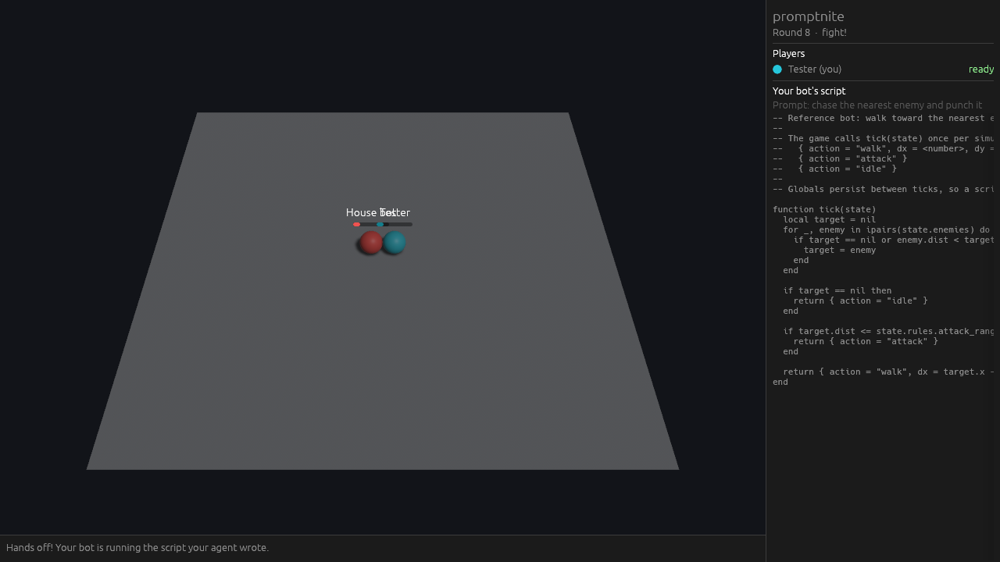

# Promptnite — game design

## The idea

An arena. Every player owns one bot in it, and the player never controls the
bot directly: their **agent** does. The player's only input is a prompt.



## Rooms

Every time a player opens the app they enter a name and a **room id**.
Everyone who enters the same id is in the same room, and each room runs its
own round loop. Ids are not case sensitive.

A room holds at most **four players**, one per edge of the arena. A fifth is
turned away until somebody leaves. Each player gets an edge when they enter:
their bot starts there, and they watch the fight from behind it.

The first player in creates the room and is its **owner**. The owner sets:

- **Match length**: the time limit of a fight, 60 seconds unless changed
  (the server accepts 15 to 120).
- **House bot**: whether the built-in reference bot fights in every match.
  On by default, so a room can be played alone. It takes an edge no player
  is using, so with four players it sits out.
- **Teleporters**: up to eight pads, anywhere on the roof a bot can stand,
  at least 2.5 units apart. The owner places and removes them by clicking
  the roof while everybody is prompting. Each pad shows its number, which is
  what prompts and scripts call it, and which decides where it leads: to the
  pad with the next number. None by default.

Changes apply from the next match. The owner stays the owner while anybody is
in the room, even while they are away themselves. A room everybody has left
goes to the next player who enters it, with the settings back to default and
the teleporters gone.

## Round loop

1. **Prompting** — every player types a prompt for their agent
   ("circle the enemy and only punch when its cooldown is running").
2. Each player's agent turns the prompt into a **Lua script**. That script is
   the bot's whole brain for the round.
3. When every player in the room has a script ready, and there are at least
   two bots counting the house bot, a **countdown** starts.
4. **Fight** — all bots run their scripts at the same time. Nobody can
   intervene.
5. **Results** — the winner is shown, then the next round starts at step 1.

## What a bot can do

Kept deliberately small for now. Each simulation tick the script returns one of:

| Action | Lua | Effect |
| --- | --- | --- |
| walk | `{ action = "walk", dx = 1, dy = 0 }` | One step in direction (dx, dy) |
| attack | `{ action = "attack" }` | Punch the nearest enemy in range |
| idle | `{ action = "idle" }` or `nil` | Nothing |

One action per tick: a bot cannot walk and punch at once.

**Teleporting** is not an action: it happens to a bot. The pads form a ring
by number. A bot whose centre comes within a pad's radius (0.9) is taken, in
that same tick, to the exact centre of the pad with the next number: 1 leads
to 2, 2 to 3, and the highest number back to the lowest. A removed pad leaves
a gap in the numbers, which the ring skips. It makes no difference how the bot
got there, so a bot can shove an enemy onto a pad. The bot that came out is
standing on a pad again, and that pad leaves it alone until it has stepped
off: from the next tick on it is free to walk away, and walking back on takes
it one pad further. A lone pad leads nowhere.

The original sketch also lists **run**. It is not implemented yet; see
"Open questions".

### The script contract

```lua
function tick(state)
  -- state.tick                      current tick, starting at 1
  -- state.me      { id, x, y, hp, cooldown }
  -- state.enemies { { id, x, y, hp, dist }, ... }   living enemies only
  -- state.teleporters { { id, x, y, dist, to }, ... }   may be empty
  -- state.arena   { half_size }
  -- state.rules   { ticks_per_sec, max_ticks, walk_speed, attack_range,
  --                 attack_damage, attack_cooldown, max_hp,
  --                 teleporter_radius }
  return { action = "walk", dx = 1, dy = 0 }
end
```

Globals persist between ticks, so a script can remember things.
`sim/scripts/chaser.lua` is the reference bot.

### Rules (all in `sim/src/rules.rs`)

- Square arena, 20 × 20 units, at most four bots. Bots are spheres of radius
  0.5, start at the middle of their own edge (1.5 units in from the wall),
  are solid (cannot overlap) and cannot leave the arena.
- 10 ticks per second. The time limit is the room's match length.
- 100 hp, a punch does 10 damage within 1.5 units, then a 5 tick cooldown.
- Walking speed 3 units per second.
- Attacks in the same tick land simultaneously, so a double knockout is
  possible.
- Last bot standing wins. At the time limit the bot with the most hp wins; a
  tie is a draw.
- A script that errors or runs out of its per-tick instruction budget makes the
  bot idle for that tick. One that goes over the memory limit is switched off
  for the rest of the match. The first error per bot is shown to everyone.

## Screen layout

The arena fills the whole window, seen from a tilted camera behind the
player's own edge, with a sphere per bot. Everything else floats over it;
there are no panels.

- **Icon**: top centre, always.
- **Join screen**: on every launch, two boxes in the middle of the window ask
  for the player's name and the room id. Enter joins. A full room says so
  under the boxes.
- **Prompt box**: once per round, the bottom 20% of the window is a multi-line
  text box. Enter adds a line, Command+Enter (or Ctrl+Enter) sends the prompt.
  Its footer shows the round. If the agent failed, the reason appears just
  above the box and the player prompts again.
- **Status line**: after sending, the box is replaced by one line at the
  bottom ("Your agent is building your bot…", "Waiting for Ada…").
- **Room and players**: top right. First the room id and its match length,
  then everyone in the room who is online, each with their bot's colour, who
  the owner is, and what they are doing: writing a prompt, agent is building,
  agent failed, ready, fighting, knocked out, won, still standing, or watching
  (they joined while a match was already running). The house bot is listed
  too while it is part of the game.
- **Room settings**: top left, for the room's owner only and only during
  prompting: the controls for match length and house bot, and the switch
  that turns clicks on the roof into placing and removing teleporters.
- **Teleporters**: a dark pad with glowing segments and its number, modelled
  in Blender (`assets/blender/teleporter.py`). When a pad takes a bot, a flame
  shoots up from it and from the pad the bot comes out of.
- **Arena overlays**: name and health bar above each bot, the big countdown
  and result text, and (top left, during and after a fight) scripts that broke.

Text boxes are 80% opaque, so the arena shows through faintly.

The player never sees Lua, not even their own bot's: the client has no way to
read scripts.

## Architecture

```
            prompt                    POST /job
 client  ───────────►  SpacetimeDB  ───────────►  agent worker ──► model API
 (Bevy)  ◄───────────    module     ◄─────────── (Cloudflare)
          game state,   (server/)    deliver_script
          match frames  validates    (HTTP reducer call)
```

| Crate | What it is |
| --- | --- |
| `sim/` | The rules, the sandboxed Lua runtime and the match loop. Pure Rust, no I/O. |
| `server/` | SpacetimeDB module: tables, reducers, phase timers. Links `sim`. |
| `bindings/` | Generated client bindings for the module (`make bindings`). |
| `client/` | Bevy client, desktop and browser. |
| `worker/` | The agent: a Cloudflare Worker (TypeScript) that turns a prompt into Lua with a model (Claude or any OpenAI-format API). |

The module, the worker and the client all log to one Axiom dataset (see
"Logging" in the README). The module and the worker send their own events; the
client's go through the worker, which holds the token.

Decisions worth knowing about:

- **The server simulates the whole match in one go.** When the last script
  arrives, a reducer runs the match to the end and stores one `frame` row per
  tick. Clients just replay the frames. This keeps the server authoritative,
  keeps Lua out of the browser, and makes matches deterministic for a given
  set of scripts and seed.
- **Lua runs in [piccolo](https://github.com/kyren/piccolo)**, a pure-Rust Lua
  VM, because the module is WebAssembly and cannot link C Lua. Scripts get
  `math`, `string`, `table` and the base library only.
- **A script cannot stall or crash a match.** The match runs inside one
  reducer, so a script that hangs it hangs the database. A module has no
  clock, so the time a tick may take is bounded by counting instead
  (`sim/src/lua.rs`): a fuel budget per tick; a 1 MB heap cap checked every
  few hundred instructions; fuel that costs more the more memory the script
  holds, because one instruction can take as long as the heap is large; and
  no string concatenation, the one operation that can allocate without bound
  between two checks. The worst script we could write keeps a four-bot,
  two-minute match under half a second (`sim/tests/sandbox.rs`).
- **The agent is a Cloudflare Worker, not part of the module.** A SpacetimeDB
  module can only make HTTP calls that finish within 500 ms, far too short for
  a model to write code. So the module only *pokes* the Worker (`POST /job`,
  answered at once) and the Worker calls the `deliver_script` reducer over
  SpacetimeDB's HTTP API when the model is done. Both directions carry
  `AGENT_SECRET`. A Worker costs nothing while idle and waiting on the model
  is not billed, which is why it is cheap.
- **The module is the only judge of a script.** The Worker does no checking
  and keeps no state. `deliver_script` validates the Lua with the sim. A valid
  script makes the player ready. An invalid one is sent back to the Worker
  with the error for one more try; until a script passes, the player just
  stays "generating". After the last failed try, or 45 s without an answer,
  the submission fails and the player can prompt again.
- **Small, fast models by default** (`claude-haiku-5-5`, `gpt-6-luna`). A bot
  script is a small task and everyone is waiting on the slowest agent.
- **Only the agent hands in scripts.** `deliver_script` needs `AGENT_SECRET`
  and there is no other way in, so every bot in a match was written from a
  prompt.
- **Every table is private.** Clients read through views that answer for the
  caller: their own player row, and the room they are in (`my_room`,
  `room_players`, `room_submissions`, `match_frames`, `match_faults`). There
  is no query that returns another room's rows. Prompts and scripts are in
  no view at all, so nobody can read them, their owner included.
- **A match is held back until its fight starts.** It is simulated when the
  last script arrives, but during the countdown `match_frames` holds only the
  opening frame, and the match length and script errors are hidden too. The
  winner is not in the room's row until the results. Once the fight starts
  the client does hold the whole replay; nothing can be changed by then.
- **Prompts are rate-limited.** A player may send one a second. Identities
  are free to make, so what protects the model API key is a budget for the
  whole database, sized for 50 people playing at once: 300 model calls a
  minute and 30,000 a day, retries included
  (`MAX_AGENT_CALLS_PER_MINUTE`, `MAX_AGENT_CALLS_PER_DAY`). Over it, prompts
  are turned away with "the agents are busy".
- **A house bot** (the reference chaser) fights in every match unless the
  room's owner switches it off, so the loop can be played solo.

## Open questions

- **Run**: the sketch lists it. Needs a cost (stamina? cannot attack while
  running?) or it simply replaces walk.
- **Prompt deadline**: a round currently waits for every online player. One
  idle player stalls the room. Add a timer and a default bot?
- **Flooding**: the model-call budget is shared, so somebody who spends it
  locks everyone else out until the minute (or day) is over. That caps the
  bill, not the nuisance. Sign-in or a per-room budget would narrow it.
- **Rooms**: anybody who knows or guesses a room id can walk in. A list of
  rooms, private rooms and matchmaking come later. Rooms are never deleted.
- **Absent owner**: if the owner leaves while others stay, nobody can change
  the settings until the owner is back or the room empties.
- **Identity**: the browser keeps your player for the tab session; the desktop
  client is a new player on every launch.
- **Agent time limit**: the Worker finishes in the background after answering
  the module, where Cloudflare allows about 30 s. Fine for a small model; a
  slow one would need a Cloudflare Queue.
- **Who pays for the agent?** One shared API key on the worker today. Options:
  bring your own key, or per-player budgets.
- **Agent depth**: today the agent is a single model call. It could become a
  real agent that tests its bot against the house bot before delivering.
- **More to do in a fight**: facing, ranged attacks, obstacles, pickups, and
  seeing what the enemy did last tick.
